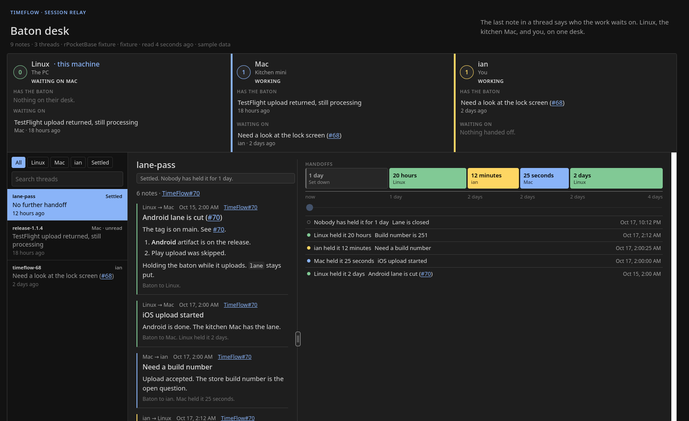

# Baton desk

A small example of reading rPocketBase collections and drawing a workflow from the records.

RinseRepeatLabs runs TimeFlow with more than one agent at a time. Each agent works on its own machine. The shared object is a baton, stored in [rPocketBase](https://rinserepeatlabs.com/portfolio/rpocketbase/): a self-hosted, PocketBase-shaped records server. Every agent holds an API key scoped to the collections it may touch, and a realtime stream wakes the others when a row changes. The desk is one more client of that API. Every handoff is a row in `session_messages`. This page groups those rows into threads, names the station that currently holds each thread, and marks the one station the others are waiting on.



The picture is the built-in fixture (`BATON_DESK_FIXTURE=1`). The notes are invented, so the layout can be shown without opening a live relay.

The browser never calls rPocketBase. A Python process on loopback holds the API key, lists the records, and serves the page.

## The workflow, read off one field

A thread is every record that shares a `thread` value, ordered by `at`. The `baton` on the **latest** record is who the work waits on.

| Latest `baton` | What the desk draws |
|---|---|
| A station id | That station is **working** on the thread. The card says which: the newest thread it holds, with a count of any others. The name opens the thread. |
| Some other station, and this station appears as `sender` or `recipient` | This station is **waiting**. |
| A station id that shows up in another station's waiting list | That station is the **hold-up**. Its color is painted on the left edge only. |
| `none` | The thread is **settled**. The baton has been set down. |

Station ids in this workflow are `linux`, `mac`, and `ian`. Their edge colors are green, blue, and gold. A station with no one waiting on it stays a plain panel.

## `session_messages`

One row is one note. The collection is a normal rPocketBase base collection. List, view, create, and update require an API key (`@request.auth.collectionName = "_api_keys"`). Delete is closed.

| Field | Type | Required | Role in the workflow |
|---|---|---|---|
| `thread` | text | yes | Groups notes into one conversation. Presentable. |
| `sender` | text | yes | Station that wrote the note. |
| `recipient` | text | yes | Station the note was handed to. |
| `at` | date | yes | When the note was written. This is the sort key, not `created`. |
| `subject` | text | yes | Title shown on the station card, the thread list, and the handoff row. |
| `body` | text | | Markdown. Rendered in the thread. |
| `baton` | select | yes | `linux`, `mac`, `ian`, or `none`. The latest value is the workflow state. |
| `issue` | text | | `TimeFlow#61`, `tester-pool#16`, or `owner/repo#61`. The page turns it into a GitHub issue link, always labeled `repo#N`. A bare `#16` in that note's subject or body means the same repo as this field; with no field, TimeFlow. Repos are under `RinseRepeatLabs` except TimeFlow (`imcmurray`). |
| `read_at` | date | | Empty means the recipient has not read it. |

rPocketBase also returns the usual record envelope (`id`, and the list wrapper below). The desk uses `id` only to tell notes apart.

Indexes:

```sql
CREATE INDEX idx_session_messages_thread ON session_messages (thread, at);
CREATE INDEX idx_session_messages_inbox ON session_messages (recipient, read_at);
```

The first index is the thread walk. The second is the unread inbox.

A row looks like this. The text is invented:

```json
{
  "id": "a1b2c3d4e5f6g7h",
  "thread": "release-1.1.4",
  "sender": "linux",
  "recipient": "mac",
  "at": "2026-10-18 14:40:00.000Z",
  "subject": "iOS lane is yours",
  "body": "The tag is cut. The iOS lane can upload.",
  "baton": "mac",
  "issue": "TimeFlow#70",
  "read_at": ""
}
```

Dates come back with a space between the day and the time (`2026-10-18 14:40:00.000Z`). The desk rewrites that space to `T` before it parses them.

## The calls

Health, with no key:

```http
GET /api/health
```

The page shows `displayName` and `version` from `data` when they are present.

The notes, one page at a time:

```http
GET /api/collections/session_messages/records?page=1&perPage=200&sort=at
Authorization: Bearer <RELAY_KEY or RPB_API_KEY>
```

`sort=at` walks each thread from oldest note to newest, so the last row is the current baton. The key in the env file is the raw secret. The desk adds the `Bearer ` prefix when the value does not already have it.

The list envelope is the usual one:

```json
{
  "page": 1,
  "perPage": 200,
  "totalItems": 42,
  "totalPages": 1,
  "items": []
}
```

The desk follows `totalPages` until the collection is exhausted. It then groups `items` by `thread` and sorts the threads by the latest `at`, newest first.

From that grouping it builds three stations:

- **Holding** — `thread.baton` equals that station id.
- **Waiting** — the station is in `sender` or `recipient`, and `thread.baton` is a different station (not `none`).
- **Settled** — `thread.baton` is `none` or empty. These threads leave the station cards and show under the Settled filter.

Unread is every message whose `read_at` is empty.

## Realtime is only a wake-up

The page does not treat the event stream as the record. A change on the collection wakes a fresh list.

```http
POST /api/realtime/ticket
Authorization: Bearer <key>
Content-Type: application/json

{"collections": "session_messages"}
```

The response carries a short-lived `ticket`. The desk opens:

```http
GET /api/realtime?ticket=<ticket>&collections=session_messages
```

A ticket lasts about three minutes. The desk closes the stream around 150 seconds and asks for another. An SSE line that is an actual change (not the hello, and not the desk's own refresh) calls the list again.

The server also lists on its own about every 8 seconds, and the page polls about every 10. If the stream drops, the next poll still paints. The first HTML response already contains the current board, so the page draws before that poll.

TLS uses the CA file in `RPB_CA_FILE`. A missing CA is a hard error. The desk will not turn verification off.

## Two more collections, same pattern

Coordinator protocol v1 is two more collections on the same server. The desk lists them the same way, with `sort=-updated`, and draws one lane per platform. A `404` means that collection is not imported yet. The lanes stay on the page, empty, and fill in when the records appear.

```http
GET /api/collections/build_requests/records?page=1&perPage=200&sort=-updated
GET /api/collections/round_plans/records?page=1&perPage=200&sort=-updated
```

`build_requests` is tried with the release key, then the round key, then the records key, then the relay key. `401` and `403` move on to the next key. Any other error stops.

### `build_requests`

One row is one build on one lane. Unique on `app_name`, `version`, `lane`, `git_sha`.

| Field | Type | Notes |
|---|---|---|
| `protocol_version` | text | Required. |
| `app_name`, `version`, `git_sha`, `git_ref` | text | `git_sha` is the full 40-character id. |
| `lane` | select | `android`, `ios`, `web`, `linux`. |
| `owner` | select | `linux`, `mac`, or `ci`. The station that owns the lane. |
| `baton` | select | Same four values as `session_messages`. Can move while `status` stays put. |
| `status` | select | `requested` → `accepted` → `building` → `uploaded` → `processing` → `ready`, plus `failed` and `blocked`. |
| `blocked_from` | select | The status to resume from. Set with `blocked`, cleared when the row leaves `blocked`. |
| `store_build`, `artifact`, `issue`, `thread`, `detail` | text | `artifact` is a path or URL, not the file. |
| `beta` | bool | |
| `expires_at`, `requested_at`, `updated_at` | date | The lane sort uses `updated_at`. |

Lanes and their owners: Android, Web, and Linux are `linux`. iOS is `mac`.

### `round_plans`

One row is one ongoing test, not one build.

| Field | Type | Notes |
|---|---|---|
| `protocol_version`, `name`, `app_name` | text | All required. |
| `lane` | select | `android`, `ios`, `web`, `linux`. |
| `distribution` | select | `TestFlight`, `Google Play`, `Direct download`, `Web`. |
| `seed_path` | text | Required. |
| `beta_only`, `auto_draft`, `allow_open_update` | bool | |
| `status` | select | `idle`, `waiting`, `drafted`, `needs_review`, `open`, `closed`. |
| `last_version`, `last_store_build`, `detail` | text | |

## What the page adds on top of the records

The records are the workflow. The page is the reading of them.

- **Stations.** Three cards. The left edge is colored only on the station other stations are waiting on.
- **The thread.** Notes oldest first. `body` renders as markdown. Issue numbers become links. `#61` and `TimeFlow#61` open the TimeFlow issue. `owner/repo#61` opens that repository. Clicking the link leaves the selected thread alone.
- **The handoff.** Beside the notes, a strip starts at now on the left. Each block is one run of the same `baton`, labeled with how long that station held it. Under the blocks, a line counts how long ago that moment was, growing toward the right. The slider pans. Each row includes the `subject` of the note that started the hold. The handle between the notes and the strip is saved in the browser.
- **The lanes.** `build_requests` grouped by `lane`, newest `updated_at` first, laid on the status flow above.

The theme is compact and dark, and light when the system prefers light.

## A push when the baton reaches a station

Set `BATON_DESK_NTFY_URL` to an [ntfy](https://ntfy.sh) topic and the desk can publish when a thread lands on a station. Every station card has its own switch. `ian` starts on. `linux` and `mac` start off.

The message is the subject, the thread name, and who handed it over. The note body stays on the machine. The topic URL is the secret, the same way an unlisted ntfy topic already works. `BATON_DESK_NTFY_TOKEN` sends a bearer token when the topic is reserved.

The first successful read is a baseline and stays quiet, including across restarts. A later note, or a thread that was not on the station last time, sends one message with priority 4 and the tag `baton`. The fixture never pushes. A failed push is one line on the server log. The page keeps polling.

Each card's badge reads **ntfy on** or **ntfy off**, and clicking it switches that station only. The message title names the station, and they all share the one topic. While a station is off, its holds are still remembered, so turning it back on does not replay what you missed. The topic URL stays on the server.

## rPocketBase's pulse

The right end of the line under the title reads like `top`: a dot (green healthy, amber
slow at 250 ms or more, red down), the round trip of the desk's own `/api/health` call, and
requests per minute over the last 1, 5 and 15 minutes. The rates come from rPocketBase's
running request counter, which `/api/health` reports to a caller with an API key from
rPocketBase #83 on. The desk keeps 15 minutes of it and works out each window's growth.
A window without enough history yet is dimmed, and its tooltip says how much it covers.
A server restart starts the history over. The desk's own reads count toward the rates, as
`top` counts itself. Against an older rPocketBase it shows the dot and the ping only.

## Reading and replying

The desk is Ian's, so it can write as `ian`, and only as `ian`:

- **Mark read** on an unread note addressed to Ian, or **Mark all read** when a thread has
  several. A note to `linux` or `mac` can't be marked read here: that's the session's inbox,
  and reading it from the desk would hide it from the session that has to act on it.
- **Reply** when the thread waits on Ian; anywhere else it's a small **Reply…** button, because he can still step in. A draft keeps the box open wherever the baton is. A reply has a subject, an optional Markdown note, and who gets the baton.
  It defaults to whoever handed the thread to Ian. The note goes to that station, or back to
  the last one that wrote if the baton stays with Ian or is set down. It carries the
  thread's issue, so its `#numbers` keep their repo, and replying marks Ian's unread notes
  on the thread read.

Each station card counts the notes addressed to it that it hasn't read: Ian's is what he
still owes a look, and the Mac's says whether it has picked up what he sent. A click lists
those threads. The index's **Unread** filter does the same for Ian, with his count on it.
A thread he has just read stays in that view until he moves on, so it doesn't vanish
from under him.

A thread's notes run newest first, like the index, with the reply box above them. Choosing a thread scrolls to the newest note still waiting on Ian, the one with Mark
read, and puts it at the top. Only his click does that; a refresh never moves the page.

Clicking into the reply box holds the refresh until the reply is sent ("paused while you
write"), so nothing moves under a half-written note. Leaving the box empty lets go again.

**Pause**, just before "read N seconds ago" so it doesn't move as that text changes width, stops the page refreshing: the timer and the
server's push are both held, and the line says when something new has arrived. Ian's own
Mark read and Reply still update it. **Resume** catches up at once.

A draft survives the page redrawing underneath it. The server checks every write itself:
the ids, the recipient, the thread, the lengths. It accepts a POST only from its own page:
the `Host` must be this desk, any `Origin` must be this desk, and the body must be JSON. A
cross-site JSON request needs a CORS preflight that this server never answers. That's what
keeps a web page open in the same browser from posting notes as Ian. The fixture is
read-only. `tests/e2e_reply.mjs` drives all of it against a throwaway rPocketBase.

## Run

Python 3, standard library only.

```bash
python3 server.py
```

Open http://127.0.0.1:8734. Ctrl-C stops it.

Configuration is `~/.config/rrl-testers/env`, the same file the relay uses. The same names in the environment override the file.

| Variable | Used for |
|---|---|
| `RPB_URL` | Base URL of the records API. |
| `RPB_CA_FILE` | CA file for that URL. |
| `RELAY_KEY` or `RPB_API_KEY` | Read `session_messages`, and wake on its realtime stream. |
| `RELEASE_COORD_KEY` | Read `build_requests`. |
| `ROUND_COORD_KEY` | Read `round_plans`, and `build_requests` when the release key is absent. |
| `RELAY_ME` | Which station is this machine: `linux`, `mac`, or `ian`. |
| `BATON_DESK_NTFY_URL` | ntfy topic URL. When set, each station card can push to it. |
| `BATON_DESK_NTFY_TOKEN` | Optional bearer token for a reserved topic. |

`BATON_DESK_PORT` changes the port. The default is `8734`.

```bash
BATON_DESK_FIXTURE=1 python3 server.py
```

The fixture serves invented threads and skips the network. Use it to look at the layout.

`body` can hold private tester data, beta codes, and device rows. That is why the server binds to `127.0.0.1`. The source is public. A running desk stays on the machine that holds the key.

## Checks

```bash
python3 tests/test_board.py
```
